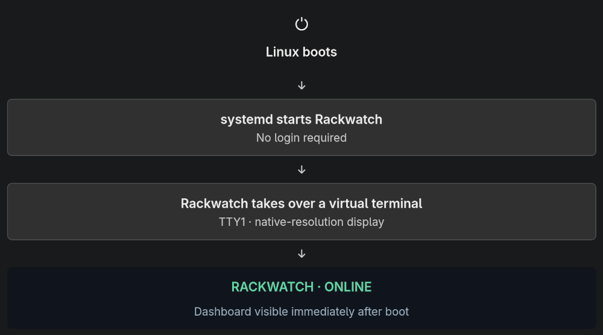

# rackwatch

<!-- markdownlint-disable MD033 -->
<p align="center">
  
</p>
<p align="center">
  For a 1424 × 280 screen in a 10-inch rack: A terminal dashboard showing CPU, RAM, disk, temperature and network for every host in the rack, each with an optional sparkline of recent history. Comes with optional touch support, Telegram integration, and more.
</p>
<p align="center">
  
  
</p>
<p align="center">
  
</p>
<!-- markdownlint-enable MD033 -->

## Quickstart

1. Review the [install.sh](./install.sh) script.

   Here's what it sets up:

   <!-- markdownlint-disable MD033 -->
   <p align="center">
     
   </p>
   <!-- markdownlint-enable MD033 -->

2. **Run the same command for both installation and update**:

   ```sh
   curl -fsSL https://raw.githubusercontent.com/m5lk3n/rackwatch/main/install.sh | sudo sh
   ```

3. [Configure](#configuration).

## Uninstallation

To uninstall, run [uninstall.sh](./uninstall.sh). It keeps `/etc/rackwatch/` and the `rackwatch` user unless you add `--purge`:

```sh
curl -fsSL https://raw.githubusercontent.com/m5lk3n/rackwatch/main/uninstall.sh | sudo sh
```

```sh
curl -fsSL https://raw.githubusercontent.com/m5lk3n/rackwatch/main/uninstall.sh | sudo sh -s -- --purge
```

## TL;DR

rackwatch is a single Go binary that runs a full-screen terminal dashboard on the small display of a 10-inch rack. It shows one column per host, up to 10 hosts, with CPU, RAM, disk, temperature and network. Each metric gets a sparkline of recent history, and each host shows as UP, STALE or DOWN.

- **Installation**: [install.sh](./install.sh) downloads the latest release and checks its checksum. It installs the binary to `/opt/rackwatch/` and sets up a systemd service that runs as the `rackwatch` user on TTY1, replacing the login prompt there. Run the same command again to update.
- **Config**: a single TOML file, `/etc/rackwatch/config.toml`, created from [config.toml.example](config.toml.example) and never overwritten by updates. List your hosts there, plus optional settings for the theme, [screensaver](images/screensaver.png), night blackout, touchscreen and Telegram alerts. See [Configuration](#configuration).
- **Dashboard**: refreshes every 30 seconds by default and keeps its history in memory. It never blocks on a slow host. Values over a threshold are highlighted. Press `r` or tap `[ refresh ]` to refresh now, `q` to quit. See [Running](#running).
- **node_exporter**: the machine running rackwatch can read its own metrics (`metrics_source = "local"`). Every other host needs [node_exporter](https://github.com/prometheus/node_exporter) on port 9100. Install it from your distribution's package manager. It's lightweight and doesn't need a Prometheus server. See [Setting up remote hosts](#setting-up-remote-hosts).

## Constraints

- A 1424 × 280 screen in a 10-inch rack: about 178 × 17 cells with an 8 × 16 font. Tested on a "GeeekPi 6,91 Zoll 1424x280 LCD Touchscreen".
- The panel hides the console's top row, 5 columns on the left and 4 on the right, so the config sets `margin_top = 1`, `margin_left = 5` and `margin_right = 4`.
- The screen is wide and short, so each host gets its own column. Sparklines grow to fill the height that's left.

## Starting

Manual start if not installed via [install.sh](./install.sh):

```sh
cp config.toml.example config.toml      # then edit the hosts
./rackwatch                             # reads ./config.toml
./rackwatch -config path/to/config.toml
./rackwatch version                     # prints the version and who built it
```

## Running

| Key | Action |
| --- | --- |
| `r` | Refresh now |
| `q`, `Esc`, `Ctrl-C` | Quit |

On a touchscreen, or with a mouse, tap `[ refresh ]` in the header to refresh now. Tap `[ restart ]` and then `[ restart? ]` within 5 seconds to restart rackwatch with the same arguments; the second tap stops a stray touch from restarting it. A restart reads the config file again, so it applies changes to `config.toml` without leaving the dashboard; if the edited config is invalid, rackwatch prints the error and exits. A tap that ends the screensaver or wakes the screen during the blackout only does that. On the Linux text console, taps only reach rackwatch with [`touch`](#touchscreen) set up; in a terminal window they work as they are.

CPU and NET show `--` until a host's second successful fetch, normally one `refresh_seconds` after startup. Both are rates, so they need two readings to compare. RAM, disk and temperature show up right away.

## Configuration

See [config.toml.example](config.toml.example) for a full example.

| Setting | Meaning |
| --- | --- |
| `dashboard.refresh_seconds` | How often to fetch metrics (default `30`) |
| `dashboard.stale_after` | How old data can get before a host shows as STALE, e.g. `"300s"` (default `"300s"`) |
| `dashboard.down_after` | How old data can get before a STALE host shows as DOWN, e.g. `"12h"` (default `"12h"`) |
| `dashboard.theme` | `"default"`, `"archaic"`, `"fortuna"`, `"gaia"`, `"hinterland"` or `"noir"` (default `"default"`) |
| `dashboard.show_sparklines` | Show the history graphs (default `true`) |
| `dashboard.spark_glyphs` | `"eighths"` draws bars in eighth-row steps (`▁▂▃…█`). `"halves"` uses only `▄` and `█`. `"line"` draws just the top of each bar with `_`, `-` and `¯`, which every Linux text console font has; the eighth blocks show as diamonds there. `"auto"` picks `"line"` when running on a Linux virtual console (`/dev/ttyN`) or with `TERM=linux` (default `"auto"`) |
| `dashboard.condensed` | Show each metric on a single row, without the extra rows that normally hold taller sparklines. Panels are only as tall as their content (7 rows) instead of filling the screen (default `false`) |
| `dashboard.margin_top`, `margin_bottom`, `margin_left`, `margin_right` | Rows and columns to leave blank at each edge of the terminal, for parts the screen hides (default `0`) |
| `screensaver.enabled` | Show the [digital rain](images/screensaver.png) from The Matrix now and then, so the screen doesn't keep the same image (default `true`). Any key or touch ends it early; `Ctrl-C` still quits |
| `screensaver.interval` | How often the screensaver starts, e.g. `"10m"` (default `"10m"`) |
| `screensaver.duration` | How long it runs, e.g. `"10s"`. Must be shorter than `interval` (default `"10s"`) |
| `blackout.enabled` | Keep the screen black at night (default `true`). Any key or touch shows the dashboard for a minute (mouse movement doesn't count); polling and Telegram alerts carry on. The screensaver doesn't run while the screen is black. On the Linux console the display is also switched off with `setterm --blank force`, which can turn off the backlight too; this needs `setterm` (from util-linux) and the console to be rackwatch's controlling terminal, as when it runs as a service on a tty. Whether the screen actually goes dark depends on its firmware: some keep the backlight on without a signal, or wake up again by themselves after a few minutes. To be sure it's off at night, cut the screen's power instead, e.g. with [uhubctl](https://github.com/mvp/uhubctl) when it's powered over USB, or with a timer or smart plug. If the touchscreen shares that USB connection, taps can't wake the dashboard while it's off. When stderr isn't a terminal, as with the service, rackwatch logs when the screen goes off and on and what woke it, so `journalctl -u rackwatch` shows why it came back |
| `blackout.from`, `until` | When the screen is black, in the local time of the machine running the dashboard. The period may wrap past midnight; set both to the same time to turn it off (default `"23:00"` and `"08:00"`) |
| `telegram.enabled` | Send a Telegram message when a host goes down or recovers, see [Telegram alerts](#telegram-alerts) (default `false`) |
| `telegram.bot_token` | The bot's token from [@BotFather](https://t.me/BotFather), e.g. `"123456789:ABC-DEF..."` |
| `telegram.chat_id` | Where to send messages: a numeric chat ID, or `"@channelname"` for a public channel |
| `telegram.quiet_from`, `quiet_until` | No messages between these times, in the local time of the machine running the dashboard. The period may wrap past midnight; set both to the same time to turn it off (default `"23:00"` and `"08:00"`) |
| `touch.enabled` | Read a touchscreen directly on the Linux text console, see [Touchscreen](#touchscreen) (default `false`) |
| `touch.device` | The touchscreen's input device, e.g. `"/dev/input/by-id/usb-…-event-if00"` |
| `touch.swap_xy`, `invert_x`, `invert_y` | If taps land in the wrong place: swap the axes when the touchscreen is turned against the display, invert one when it's mirrored (default `false`) |
| `log.debug` | Also log each touch and tap, see [Touchscreen](#touchscreen). Like all of rackwatch's logging, this goes to stderr only when stderr isn't a terminal, as with the service, where `journalctl -u rackwatch` shows it (default `false`) |
| `thresholds.*_warning` | Values at or above these are highlighted. Temperature is in °C |
| `hosts[].name` | Name shown on the panel. Up to 10 enabled hosts can be configured |
| `hosts[].metrics_source` | `"local"`, or the URL of a [node_exporter](https://github.com/prometheus/node_exporter), e.g. `"http://host:9100/metrics"` |
| `hosts[].enabled` | Set to `false` to hide a host without deleting its entry. Disabled entries aren't validated and don't count toward the limit (default `true`) |

String values need quotes in TOML: `theme = "fortuna"`, not `theme = fortuna`. The program stops at startup with the line number if the file doesn't parse, or if it has unknown keys or invalid values.

### Themes

- **`default`**: inspired by VS Code's Dark 2026 theme. Light grey text on charcoal, faint borders, a steel blue header and sparklines, and amber for values over a threshold.
- **`archaic`**: the dark variant of [archaic](https://raw.githubusercontent.com/protesilaos/prot16/master/utils/scrots/archaic_dark.png) by Protesilaos Stavrou, earthy colors inspired by ancient wall paintings. Light grey text on warm dark brown, a cream header, teal sparklines and orange for values over a threshold.
- **`fortuna`**: the dark variant of [fortuna](https://raw.githubusercontent.com/protesilaos/prot16/master/utils/scrots/fortuna_dark.png), also by Protesilaos Stavrou: high contrast with bright, playful colors. Sage text on reddish brown, an off-white header, turquoise sparklines and orange for values over a threshold.
- **`gaia`**: the dark variant of [gaia](https://raw.githubusercontent.com/protesilaos/prot16/master/utils/scrots/gaia_dark.png): low-to-medium contrast with an earthy feel. Sage text on charcoal, an off-white header, green-teal sparklines and ochre for values over a threshold.
- **`hinterland`**: the dark variant of [hinterland](https://raw.githubusercontent.com/protesilaos/prot16/master/utils/scrots/hinterland_dark.png): high contrast, inspired by mountain ranges and rural regions in early spring. Grey-blue text on near-black, a white header, teal sparklines and copper for values over a threshold.
- **`noir`**: the dark variant of [noir](https://raw.githubusercontent.com/protesilaos/prot16/master/utils/scrots/noir_dark.png): low contrast, inspired by nights in the wilderness. Muted teal text on almost-black green, a sand-colored header, blue-green sparklines and olive-gold for values over a threshold.

On the Linux console, rackwatch loads the theme's colors into the console's 16 color slots at startup and restores the default colors on exit. If it is killed without a chance to clean up, run `setterm --reset` or `reset` to get them back.

## Touchscreen

In a terminal window, taps on a touchscreen reach rackwatch like mouse clicks, with nothing to set up. On the Linux text console nothing passes them on, except gpm, which treats a touchscreen as a mouse and misses where the finger is. There, rackwatch reads the touchscreen itself:

1. Find the device. `ls -l /dev/input/by-id/` lists stable names, which survive a reboot or replugging, unlike `/dev/input/eventN`. A panel often shows up more than once, e.g. as `…-event-if00` and `…-if02-event-mouse`. Run `sudo evtest`, pick each `event` device in turn and tap the screen: the right one reports `ABS_X`, `ABS_Y` and `BTN_TOUCH`. In `/proc/bus/input/devices` it's usually the one with `PROP=2`.
2. Let the user running rackwatch read it. Input devices belong to the `input` group, so without it rackwatch can't open the device; evtest only worked because of `sudo`. The service installed by [install.sh](./install.sh) already runs with the `input` group, so skip this step for it. When running rackwatch yourself, add yourself to the group, then **log out and back in**, since group changes only apply to new logins:

   ```sh
   sudo usermod -aG input $USER
   ```

3. Set it in the config:

   ```toml
   [touch]
   enabled = true
   device = "/dev/input/by-id/usb-wch.cn_TouchScreen_9LQ0172005164-event-if00"
   ```

If taps land in the wrong place, the touchscreen is turned or mirrored against the display: set `swap_xy`, `invert_x` or `invert_y` to `true`.

If taps do nothing, look at why the device couldn't be read. If it's missing, unplugged or unreadable, rackwatch carries on without it and tries again every 5 seconds. It logs the reason to stderr, but only when stderr isn't the terminal, so the dashboard isn't garbled. With the service, `journalctl -u rackwatch | grep touch` shows it. Run directly, send stderr to a file: `./rackwatch 2>touch.log`. A device that opened logs `msg="reading touchscreen" component=touch device=… x=0..N y=0..M`; otherwise the log gives the error, most often `permission denied`.

If taps land somewhere unexpected, set `debug = true` under `[log]` and restart. Each touch then logs its position on the device (`dev_x`, `dev_y`) and the cell it maps to (`x`, `y`), and each tap logs the header button it hit, if any (`button=refresh`, `restart` or `none`).

## Setting up remote hosts

Every host with a URL as its `metrics_source` must run [node_exporter](https://github.com/prometheus/node_exporter). It's the official Prometheus exporter for host metrics on Linux, but it isn't part of Prometheus and isn't installed by default on any distribution. Its default address, `:9100/metrics`, is the one the example config uses.

Other Prometheus-compatible exporters, such as Netdata or Telegraf, won't work. They use the same text format but different metric names, and the TUI looks for node_exporter's names, such as `node_cpu_seconds_total`. Hosts running them show as DOWN with "no node_exporter metrics in response".

| Distribution | Install | Service |
| --- | --- | --- |
| Arch Linux | `sudo pacman -S prometheus-node-exporter` | Enable it yourself: `sudo systemctl enable --now prometheus-node-exporter` |
| Debian, Ubuntu | `sudo apt install --no-install-recommends prometheus-node-exporter` | Enabled and started on install. Set flags in `/etc/default/prometheus-node-exporter`. |

On Debian and Ubuntu, `--no-install-recommends` skips `prometheus-node-exporter-collectors`. That package adds systemd timers that run scripts for apt, SMART and NVMe metrics, and the TUI doesn't use any of them. Everything it reads comes from node_exporter's built-in collectors.

node_exporter has a small footprint. It does nothing until the TUI fetches `/metrics`. Each fetch reads the kernel's in-memory `/proc` and `/sys` files, takes a few tens of milliseconds of CPU and doesn't touch the disk. node_exporter writes nothing to disk and stores no history. It typically uses 15–30 MB of RAM. The TUI keeps its history in memory, so remote hosts don't need a Prometheus server.

**Very old releases:** node_exporter renamed its metrics in version 0.16 (2018), for example `node_cpu` to `node_cpu_seconds_total`. Ubuntu 18.04 ships an older version, so its hosts show as DOWN. Debian and Ubuntu releases from about 2019 onward work.

To check that a host serves the metrics the TUI needs:

```sh
curl -s http://rack-02.internal:9100/metrics | grep -m1 node_cpu_seconds_total
```

If that prints a line, the TUI can read the host.

## When a remote source is unavailable

- **The UI never waits on the network.** Each host has at most one fetch running at a time, in the background, with a timeout of `max(refresh, 30s)`. A host that hangs can't freeze the screen or delay the other hosts, and fetches don't pile up.
- **The last good values stay on screen.** When a fetch fails, the values turn grey and the sparkline shows a `·` gap, so you can see the outage in the history.
- **Each host shows a status:**
  - **UP** while data is fresh.
  - **STALE 302s** once the last good data is older than `stale_after`.
  - **DOWN** if the host has never answered, or its last good data is older than `down_after`.

  A short version of the error (e.g. `timeout`, `connection refused`, `unknown host`) appears on the bottom edge of the panel.
- **Wrong responses are errors too.** A non-200 response, or a page that doesn't look like node_exporter output, counts as a failure rather than showing zeros. If a counter goes backwards (a reboot or exporter restart), that one reading's CPU and network rates are skipped instead of showing a nonsense value.
- **Thresholds are highlighted.** Values at or above `[thresholds]` are highlighted, and so are the individual sparkline bars that crossed them. The highlight is each theme's warning color.

## Telegram alerts

With `[telegram]` enabled, rackwatch messages a chat when a host goes down and again when it recovers:

```text
⚠️ rackbox-02 is not reachable, no data since 14:02: connection refused
⛔ rackbox-02 went from STALE to DOWN, no data since Oct 15 14:02 (12h0m0s): connection refused
⛔ rackbox-03 is DOWN, never reached since rackwatch started: unknown host
✅ rackbox-02 is back up after 25m
```

- **Down** means the panel shows STALE or DOWN. One failed fetch isn't enough: a host that was up is reported once its data is older than `stale_after`, and again when it turns DOWN after `down_after`. A host that has never answered since rackwatch started is reported right away.
- **Quiet hours** hold messages back rather than dropping them. When they end, any host that's still down, or that recovered from an outage you were told about, is reported then. An outage that starts and ends within quiet hours isn't reported at all.
- **Failed sends** show in the header as `TELEGRAM` and the error (e.g. `Unauthorized`, `Bad Request: chat not found`) and are retried a minute later. Messages are sent in the background, so a slow or unreachable Telegram never blocks the screen.

To set it up:

1. Message [@BotFather](https://t.me/BotFather) in Telegram, send `/newbot` and follow the steps. Put the token it gives you in `bot_token`. Anyone with the token can control the bot, **so keep `config.toml` private**; it's already in `.gitignore`.
2. Send your new bot any message, so it's allowed to message you back. For a group, add the bot to the group instead.
3. Look up the chat ID, then put it in `chat_id`:

   ```sh
   curl -s https://api.telegram.org/bot<token>/getUpdates | grep -o '"chat":{"id":-\?[0-9]*'
   ```

   Group IDs are negative, e.g. `-1001234567890`.

## Limitations

- Remote URLs only work with node_exporter's format.
- The `local` source only works on Linux.
- Disk usage covers only the `/` mount.
- Network traffic adds up all interfaces except loopback and virtual ones like `veth*`, `docker*` and `br-*`.

---

## Development

### Prerequisites

- `make`
- `go 1.27+`
- optional: [todo.txt-cli](https://github.com/todotxt/todo.txt-cli) with `alias t='todo.sh -d ./todo.cfg'`

### Build

```sh
make build
```

### Test

```sh
make test
```

### Release

```sh
NEW_VERSION=v0.3.1 # bump <major>.<minor>.<patch> accordingly
git tag "$NEW_VERSION" && git push origin "$NEW_VERSION"
```

### Files

| File | Contents |
| --- | --- |
| [main.go](main.go) | The main loop |
| [config.go](config.go) | Loads and checks the config |
| [collect.go](collect.go) | Collects metrics. `local` reads `/proc`, `statfs("/")` and the hwmon/thermal sensors. URLs are parsed as node_exporter output without an extra dependency. |
| [host.go](host.go) | Per-host state, the ring buffer of recent samples, and the status logic |
| [view.go](view.go) | Drawing |
| [telegram.go](telegram.go) | Telegram alerts: when to send, quiet hours, and the Bot API call |
| [theme.go](theme.go) | Theme definitions. To add one, write another function and add it to the `themes` map. Styles use the 16 color slots, with only the first 8 as backgrounds, or the theme breaks on the Linux console; a test checks this. To use custom colors, set `palette` with the RGB value of each slot, as the Prot16 themes do. For another Prot16 dark variant, or any palette laid out the same way (as the default theme is), pass its 16 colors to `prot16Dark`. |
| [main_test.go](main_test.go) | Tests for the parser, rate calculation, ring buffer, unreachable-host handling, the local collector, themes, rendering, and Telegram alerts |

---

## Sources

- The default theme uses selected colors from VS Code's [Dark 2026 theme](https://github.com/microsoft/vscode/blob/main/extensions/theme-defaults/themes/2026-dark.json), from the MIT-licensed [Visual Studio Code project](https://github.com/microsoft/vscode/blob/main/LICENSE.txt).
- The `archaic`, `fortuna`, `gaia`, `hinterland` and `noir` palettes adapt dark color schemes from [Prot16](https://github.com/protesilaos/prot16).
- The screensaver is an independent implementation inspired by the digital-rain visual effect associated with The Matrix.
- The lttl.dev logo in the footer is my own.

## Disclaimer

- rackwatch's own code is distributed under the MIT License in [LICENSE](LICENSE). Third-party works retain their respective licenses; this project's license does not relicense them.
- Prot16 is copyright (c) 2017 Protesilaos Stavrou and is licensed under GPL-3.0-or-later. This project adapts its named palettes as RGB values and does not include Prot16 source files. Whether those palette adaptations are covered by GPL and how that interacts with rackwatch's MIT license has not been determined. Treat this as an unresolved license-compatibility question before redistributing the Prot16-based themes; replacing them with independently developed palettes or obtaining qualified licensing advice would resolve the uncertainty.
- VS Code is a Microsoft trademark. The Matrix is a third-party title and mark. These names are used only to identify sources or describe visual inspiration; rackwatch is not affiliated with or endorsed by Microsoft or the rights holders of The Matrix. All third-party names and marks belong to their respective owners.
- Go module dependencies have their own licenses (including MIT, Apache-2.0 and BSD-style licenses). The release archives currently include rackwatch's [LICENSE](LICENSE), but do not bundle the dependency license texts; consult [go.mod](go.mod) and the upstream module license files before redistributing those archives.
- The [logo](images/logo.png) is custom-generated art made with Claude Code. AI tools (Claude Code, Copilot and ChatGPT) were used in developing the project.
- Use rackwatch at your own risk. It is provided without warranty; take care when installing it on hardware or running the installer with elevated privileges.

---

<!-- markdownlint-disable MD033 -->
<p align="center">
    <a href="https://lttl.dev/"></a>
</p>
