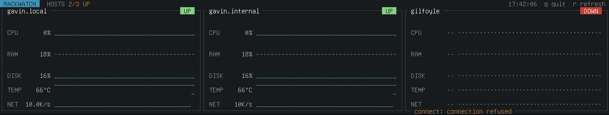

# rackwatch

<!-- markdownlint-disable MD033 -->
<p align="center">
  
</p>
<p align="center">
  A terminal dashboard showing CPU, RAM, disk, temperature and network for every host in the rack, each with an optional sparkline of recent history.
</p>
<p align="center">
  
  
</p>
<p align="center">
  
</p>
<!-- markdownlint-enable MD033 -->

## Constraints

- A 1424 × 280 screen in a 10-inch rack: about 178 × 17 cells with an 8 × 16 font.
- The panel hides the console's top row, 5 columns on the left and 4 on the right, so the config sets `margin_top = 1`, `margin_left = 5` and `margin_right = 4`.
- The screen is wide and short, so each host gets its own column. Sparklines grow to fill the height that's left.

## Building

```sh
make build
```

## Testing

```sh
make test
```

## Running

```sh
cp config.toml.example config.toml      # then edit the hosts
./rackwatch                             # reads ./config.toml
./rackwatch -config path/to/config.toml
```

| Key | Action |
| --- | --- |
| `r` | Refresh now |
| `q`, `Esc`, `Ctrl-C` | Quit |

## Configuration

See [config.toml.example](config.toml.example) for a full example.

| Setting | Meaning |
| --- | --- |
| `dashboard.refresh_seconds` | How often to fetch metrics (default `30`) |
| `dashboard.stale_after` | How old data can get before a host shows as STALE, e.g. `"300s"` (default `"300s"`) |
| `dashboard.theme` | `"default"`, `"archaic"`, `"fortuna"`, `"gaia"`, `"hinterland"` or `"noir"` (default `"default"`) |
| `dashboard.show_sparklines` | Show the history graphs (default `true`) |
| `dashboard.spark_glyphs` | `"eighths"` draws bars in eighth-row steps (`▁▂▃…█`). `"halves"` uses only `▄` and `█`. `"line"` draws just the top of each bar with `_`, `-` and `¯`, which every Linux text console font has; the eighth blocks show as diamonds there. `"auto"` picks line when running on a Linux virtual console (`/dev/ttyN`) or with `TERM=linux` (default `"auto"`) |
| `dashboard.condensed` | Show each metric on a single row, without the extra rows that normally hold taller sparklines. Panels are only as tall as their content (7 rows) instead of filling the screen (default `false`) |
| `dashboard.margin_top`, `margin_bottom`, `margin_left`, `margin_right` | Rows and columns to leave blank at each edge of the terminal, for parts the screen hides (default `0`) |
| `screensaver.enabled` | Show the digital rain from The Matrix now and then, so the screen doesn't keep the same image (default `true`). Any key or touch ends it early; `Ctrl-C` still quits |
| `screensaver.interval` | How often the screensaver starts, e.g. `"10m"` (default `"10m"`) |
| `screensaver.duration` | How long it runs, e.g. `"10s"`. Must be shorter than `interval` (default `"10s"`) |
| `thresholds.*_warning` | Values at or above these are highlighted. Temperature is in °C. |
| `hosts[].name` | Name shown on the panel. Up to 10 enabled hosts can be configured. |
| `hosts[].metrics_source` | `"local"`, or the URL of a [node_exporter](https://github.com/prometheus/node_exporter), e.g. `"http://host:9100/metrics"` |
| `hosts[].enabled` | Set to `false` to hide a host without deleting its entry. Disabled entries aren't validated and don't count toward the limit (default `true`) |

String values need quotes in TOML: `theme = "fortuna"`, not `theme = fortuna`. The program stops at startup with the line number if the file doesn't parse, or if it has unknown keys or invalid values.

### Themes

- **`default`**: inspired by VS Code's Dark 2026 theme. Light grey text on charcoal, faint borders, a steel blue header and sparklines, and amber for values over a threshold.
- **`archaic`**: the dark variant of [archaic](https://raw.githubusercontent.com/protesilaos/prot16/master/utils/scrots/archaic_dark.png) by Protesilaos Stavrou, earthy colors inspired by ancient wall paintings. Light grey text on warm dark brown, a cream header, teal sparklines and orange for values over a threshold.
- **`fortuna`**: the dark variant of [fortuna](https://raw.githubusercontent.com/protesilaos/prot16/master/utils/scrots/fortuna_dark.png), also by Protesilaos Stavrou: high contrast with bright, playful colors. Sage text on reddish brown, an off-white header, turquoise sparklines and orange for values over a threshold.
- **`gaia`**: the dark variant of [gaia](https://raw.githubusercontent.com/protesilaos/prot16/master/utils/scrots/gaia_dark.png): low-to-medium contrast with an earthy feel. Sage text on charcoal, an off-white header, green-teal sparklines and ochre for values over a threshold.
- **`hinterland`**: the dark variant of [hinterland](https://raw.githubusercontent.com/protesilaos/prot16/master/utils/scrots/hinterland_dark.png): high contrast, inspired by mountain ranges and rural regions in early spring. Grey-blue text on near-black, a white header, teal sparklines and copper for values over a threshold.
- **`noir`**: the dark variant of [noir](https://raw.githubusercontent.com/protesilaos/prot16/master/utils/scrots/noir_dark.png): low contrast, inspired by nights in the wilderness. Muted teal text on almost-black green, a sand-colored header, blue-green sparklines and olive-gold for values over a threshold.

On the Linux console, rackwatch loads the theme's colors into the console's 16 color slots at startup and restores the default colors on exit. If it is killed without a chance to clean up, run `setterm --reset` or `reset` to get them back.

## Setting up remote hosts

Every host with a URL as its `metrics_source` must run [node_exporter](https://github.com/prometheus/node_exporter). It's the official Prometheus exporter for host metrics on Linux, but it isn't part of Prometheus and isn't installed by default on any distribution. Its default address, `:9100/metrics`, is the one the example config uses.

Other Prometheus-compatible exporters, such as Netdata or Telegraf, won't work. They use the same text format but different metric names, and the TUI looks for node_exporter's names, such as `node_cpu_seconds_total`. Hosts running them show as DOWN with "no node_exporter metrics in response".

| Distribution | Install | Service |
| --- | --- | --- |
| Arch Linux | `sudo pacman -S prometheus-node-exporter` | Enable it yourself: `sudo systemctl enable --now prometheus-node-exporter` |
| Debian, Ubuntu | `sudo apt install prometheus-node-exporter` | Enabled and started on install. Set flags in `/etc/default/prometheus-node-exporter`. |

**Very old releases:** node_exporter renamed its metrics in version 0.16 (2018), for example `node_cpu` to `node_cpu_seconds_total`. Ubuntu 18.04 ships an older version, so its hosts show as DOWN. Debian and Ubuntu releases from about 2019 onward work.

To check that a host serves the metrics the TUI needs:

```sh
curl -s http://rack-02.internal:9100/metrics | grep -m1 node_cpu_seconds_total
```

If that prints a line, the TUI can read the host.

## When a remote source is unavailable

- **The UI never waits on the network.** Each host has at most one fetch running at a time, in the background, with a timeout of `max(refresh, 30s)`. A host that hangs can't freeze the screen or delay the other hosts, and fetches don't pile up.
- **The last good values stay on screen.** When a fetch fails, the values turn grey and the sparkline shows a `·` gap, so you can see the outage in the history.
- **Each host shows a status:**
  - **UP** while data is fresh.
  - **STALE 302s** once the last good data is older than `stale_after`.
  - **DOWN** if the host has never answered.

  A short version of the error (e.g. `timeout`, `connection refused`, `unknown host`) appears on the bottom edge of the panel.
- **Wrong responses are errors too.** A non-200 response, or a page that doesn't look like node_exporter output, counts as a failure rather than showing zeros. If a counter goes backwards (a reboot or exporter restart), that one reading's CPU and network rates are skipped instead of showing a nonsense value.
- **Thresholds are highlighted.** Values at or above `[thresholds]` are highlighted, and so are the individual sparkline bars that crossed them. The highlight is each theme's orange.

## Files

| File | Contents |
| --- | --- |
| [main.go](main.go) | The main loop |
| [config.go](config.go) | Loads and checks the config |
| [collect.go](collect.go) | Collects metrics. `local` reads `/proc`, `statfs("/")` and the hwmon/thermal sensors. URLs are parsed as node_exporter output without an extra dependency. |
| [host.go](host.go) | Per-host state, the ring buffer of recent samples, and the status logic |
| [view.go](view.go) | Drawing |
| [theme.go](theme.go) | Theme definitions. To add one, write another function and add it to the `themes` map. Styles use the 16 color slots, with only the first 8 as backgrounds, or the theme breaks on the Linux console; a test checks this. To use custom colors, set `palette` with the RGB value of each slot, as the Prot16 themes do. For another Prot16 dark variant, or any palette laid out the same way (as the default theme is), pass its 16 colors to `prot16Dark`. |
| [main_test.go](main_test.go) | Tests for the parser, rate calculation, ring buffer, unreachable-host handling, the local collector, themes, and rendering |

## Limitations

- Remote URLs only work with node_exporter's format.
- The `local` source only works on Linux.
- Disk usage covers only the `/` mount.
- Network traffic adds up all interfaces except loopback and virtual ones like `veth*`, `docker*` and `br-*`.

## Prerequisites

### Development

- `make`
- `go 1.27+`
- optional: [todo.txt-cli](https://github.com/todotxt/todo.txt-cli) with `alias t='todo.sh -d ./todo.cfg'`

Create a release with

```sh
git tag v0.1.0 && git push origin v0.1.0
```

## Sources

- The default theme takes its colors from VS Code's [Dark 2026 theme](https://github.com/microsoft/vscode/blob/main/extensions/theme-defaults/themes/2026-dark.json).
- The other dashboard themes are dark variants from [Prot16 general resources](https://github.com/protesilaos/prot16).
- The screensaver (digital rain) is heavily inspired from The Matrix movie.
- The lttl.dev logo in the footer is my own.

## Disclaimer

- I'm neither responsible for any damage to your devices nor for external links.
- I used AI (Claude Code, Copilot and ChatGPT) to realize this project. The [logo](images/logo.png) is custom-generated art by Claude Code.

---

<!-- markdownlint-disable MD033 -->
<p align="center">
    <a href="https://lttl.dev/"></a>
</p>
